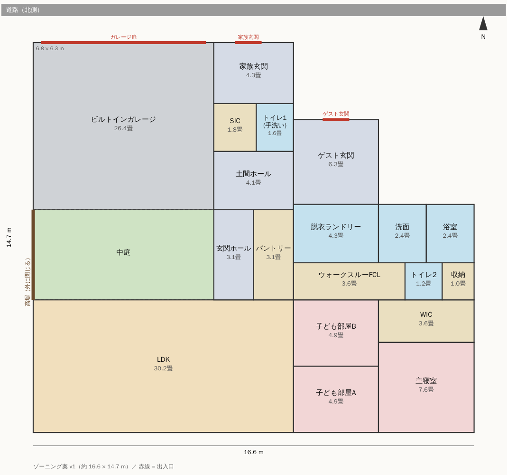
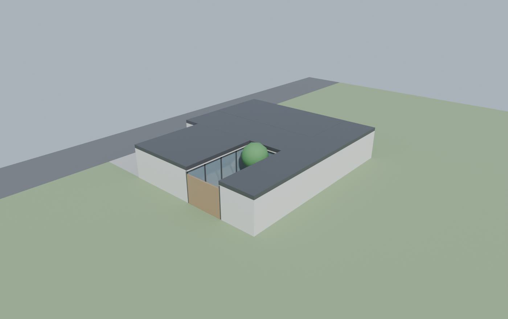
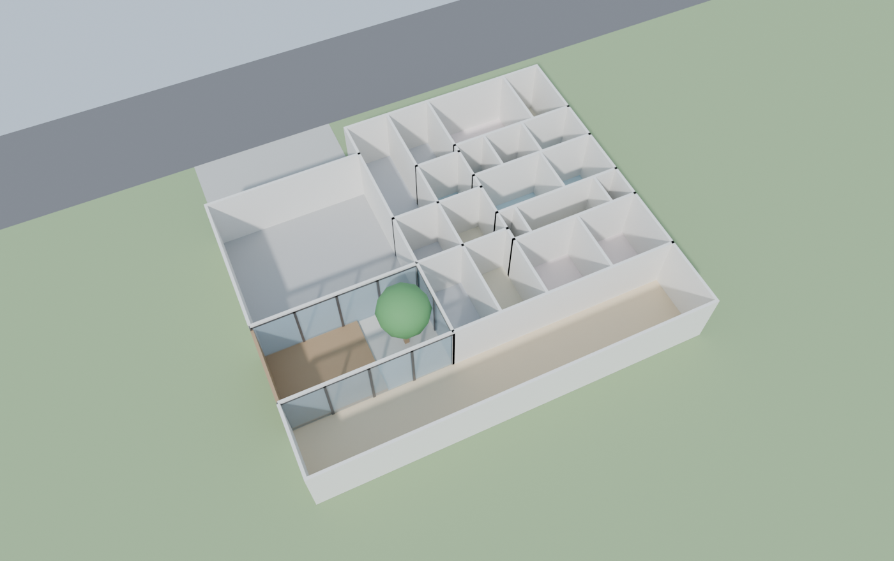

# 理想の平屋 計画

「外に閉じ、中に開く」コの字型コートハウスの平屋を計画するリポジトリ。要件を書き、間取りをデータで持ち、Blender で3D化して見比べる。



| 外観（屋根あり） | 断面（屋根なし） |
| --- | --- |
|  |  |

北側の道路から見た正面は `renders/front.png`。

## 中身
| パス | 内容 |
| --- | --- |
| `docs/requirements.md` | 要件定義・設計仕様書（正本） |
| `docs/open-questions.md` | 要件とのずれ・未決事項 |
| `plan/plan.json` | 間取りデータ（各部屋の位置と大きさ、動線の要件） |
| `tools/check_plan.py` | 重なり・面積・動線のチェック |
| `tools/draw_plan.py` | 間取り図（`docs/plan.svg`）を描く |
| `blender/build_house.py` | `plan.json` から3Dモデルを組み立てて描画 |
| `renders/` | 描画結果（間取り・外観・断面・正面） |

## 使い方
```sh
python tools/check_plan.py          # 面積と動線をチェック
python tools/draw_plan.py           # docs/plan.svg を更新

pip install -r requirements.txt     # Blender 5.x（bpy）
python blender/build_house.py       # renders/*.png と blender/house.blend を更新
python blender/build_house.py cutaway   # 1枚だけ描く（aerial / cutaway / front）
```
描画は CPU の Cycles で、1枚あたり数分かかる。`blender/house.blend` は手元の Blender で開いて自由に回せる。

## 間取りを変えるには
`plan/plan.json` の `rect` は `[x, y, 幅, 奥行]`（m）。x=東、y=北、道路は北側。変えたら `check_plan.py` で重なりや動線の切れを確認してから、図と3Dを作り直す。

## 前の内容
このリポジトリは以前、旅行アプリ「PASSAGE」だった。最終状態は `claude/passage-final-archive` ブランチに残してある。
